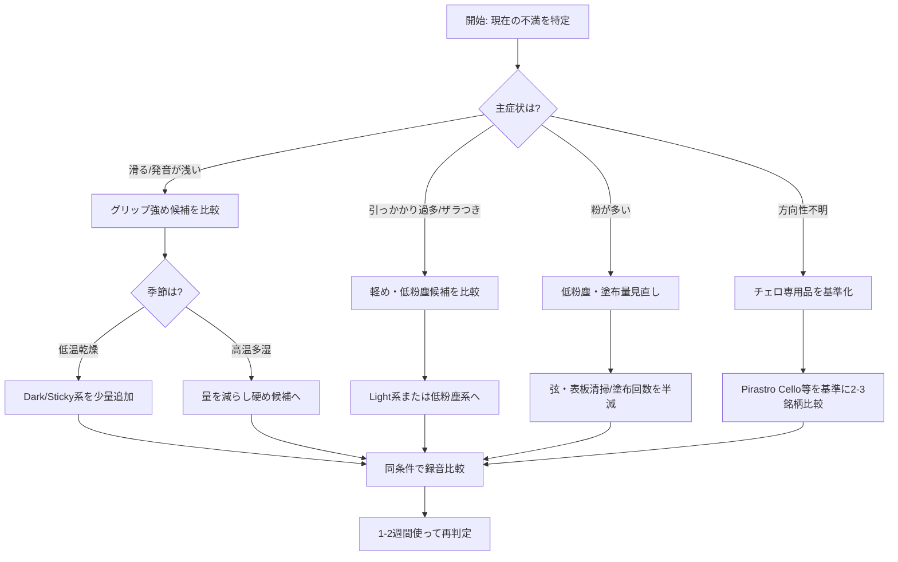

## 概要

チェロで使う主な松脂と、比較するときのポイントをまとめます。  
松脂は弓毛と弦の摩擦条件を調整する消耗品であり、**銘柄だけで結果を断定しにくい**（弓毛状態、弦、楽器、湿度、奏法の影響が大きい）点を前提に整理します。

また、配合や製法の公開範囲はメーカー・製品によって異なります。公式資料で確認できる原料と、今回確認できなかった配合比・添加素材を分けて記載します。メーカーが非公開と明示している場合は、その根拠も示します。販売店情報と公式情報も分けて扱います。

## 用語整理（松脂 / ロジン / コロホニー）

- **松脂（まつやに）**: 日本語の一般名称。弓用製品文脈では完成品（ケース入り松脂）を指すことが多いです。  
- **ロジン（Rosin）**: 英語圏での一般名称。弓用製品名にもそのまま使われます。  
- **コロホニー（Colophony / Kolophonium）**: 化学・材料文脈で使われる名称。弓用松脂でも欧州言語で表記されることがあります。

本ページでは、読者の実用性を優先して「松脂」を主表記とし、製品名や公式表記は原語を併記します。

## 原料・配合・製法（公開範囲）

- 多くの弓用松脂は、樹脂成分をベースに、硬さや粘着特性を調整した配合で作られます。  
- ただし、具体的な配合比や添加素材の全体までは、今回確認した公式資料で確認できない製品があります。製品説明に見当たらないことだけで「未公表」とは断定しません。
- 「金属粉配合」「低粉塵」「低アレルギー」などの表現は、以下のように区別して読みます。

| 情報種別 | 例 | このページでの扱い |
| --- | --- | --- |
| 公式情報 | メーカー公式サイトの製品説明 | 主要根拠として採用 |
| 販売店情報 | EC 商品説明・代理店説明 | 販売店情報ベースとして明示 |
| 一般評判 | レビュー・口コミ | 断定せず補助情報として扱う |

## 硬さ・温湿度・色の関係

- 色（Light / Dark）は参考情報にはなりますが、**主分類としては不十分**です。  
- 一般には「明色=硬め、濃色=柔らかめ」と言われますが、同名でも配合・対象楽器・ロットで印象差が出ます。  
- 実運用では、色よりも「温湿度条件での反応（滑り/引っかかり/粉）」を優先して評価するほうが再現性があります。

## 選定フローチャート（チェロ向け）

## 製品比較（チェロ向け）

> 注記: 「公式情報」はメーカー側の明示事項、「販売店情報ベース」は販売ページ中心の情報です。原料の種類と詳細な処方の確認状況は区別します。音色・演奏感の公式説明も、共通条件での実測・比較評価とは区別します。

### 1) チェロ向け（専用設計を優先）

| 製品/ライン | 区分 | 情報種別 | 技術的メモ | 実務上の見方 |
| --- | --- | --- | --- | --- |
| Pirastro Cellisto | チェロ向け | 公式情報あり | 柔らかいチェロ用松脂（公式説明）。詳細配合は今回確認した公式資料では未確認。 | Pirastro Cello との比較で硬さ方向を確認しやすい。 |
| Pirastro Cello | チェロ向け | 公式情報あり | やや硬めのチェロ用松脂（公式説明）。詳細配合は今回確認した公式資料では未確認。 | 基準銘柄として他製品比較に使いやすい。 |
| Pirastro Oliv / Evah Pirazzi Rosin | 汎用〜チェロ使用例あり | 公式情報あり | ガット弦・Evah Pirazzi 弦向け、比較的柔らかく低粉塵との公式説明。チェロ専用表記は今回確認した公式資料では未確認。 | 低粉塵・反応の比較対象として運用可能だが用途確認が必要。 |
| Kolstein Supreme Cello | チェロ向け | 公式情報あり | Normal / Medium の2種。詳細配合は今回確認した公式資料では未確認。 | 専用品群の比較軸に入れやすい。 |
| Melos Cello Light | チェロ向け | 公式情報あり | Light/Dark/Sticky/Baroque の系統展開。 | 高温期や軽い反応を狙う比較候補。 |
| Melos Cello Dark | チェロ向け | 公式情報あり | 上記と同ライン。 | 低温期やグリップ重視時の候補。 |
| Melos Cello Sticky | チェロ向け | 公式情報あり | 同ライン内で強いグリップ方向。 | 滑りが続く場合の追加候補。塗布過多に注意。 |
| Melos Cello Baroque | チェロ向け（用途限定） | 公式情報あり | ガット弦用に設計された Cello & Bass Viol 向け（公式説明）。 | 通常運用に加える前に用途適合を要確認。 |
| Petz Cello | チェロ向け | 公式情報あり | Petz のチェロ表記モデル。 | 型番/包装差があるため購入時に Cello 表記を確認。 |
| Petz Vienna’s Best | チェロ向けあり | 公式情報あり | 公式製品紹介にチェロ用と violin / viola 用を別掲載。 | 対象楽器の表記を確認して選ぶ。 |
| Nyman Cello | チェロ向け | 販売店情報ベース | Cello 表記で流通。公式仕様詳細は要追加確認。 | 実売実績は多いが最新仕様の一次確認を推奨。 |
| Hill Premium Cello（2067M） | チェロ向け | 公式情報あり（Hidersine） | Dark / Medium。主成分は colophony・natural oils（公式仕様）。 | 上級者・プロ、全年候向け（公式説明）。通常の Hill Dark（2064）と区別。 |

### 2) 汎用・低粉塵・代替系

| 製品/ライン | 区分 | 情報種別 | 技術的メモ | 実務上の見方 |
| --- | --- | --- | --- | --- |
| Bernardel | 汎用 | 販売店情報ベース | Vn/Va/Vc 対応として流通。 | 軽め方向の比較起点として使われやすい。 |
| Jade L’Opera | 汎用・低粉塵系 | 販売店情報ベース | 低粉塵傾向は販売説明で流通。 | 粉対策の候補。グリップ量は別途確認。 |
| Kaplan Premium Light | 汎用 | 公式情報あり | Light/Dark 展開。 | 引っかかり過多時の比較候補。 |
| Kaplan Premium Dark | 汎用 | 公式情報あり | 同上。 | 滑り対策側の比較候補。 |
| D’Addario Clarity Hypoallergenic | 代替系（低アレルギー訴求） | 公式情報あり | 合成炭化水素樹脂製（公式仕様）。低アレルギーを訴求（公式説明）。添加物の詳細・配合比は今回確認した公式資料では未確認。 | 皮膚刺激懸念時の候補。音色方向は要試奏確認。 |
| Archet Etude | 汎用 | 公式情報/販売情報併用 | Etude/Tenor 系列で展開。 | 基準比較を増やす用途で扱いやすい。 |
| Archet Alto | 汎用〜チェロ使用候補 | 公式情報あり | 公式では「あたたかく芯のある音色」「適度な引っかかり」「Soprano に比べ粉末が飛びにくい」と説明される。粘度は Archet 内では低〜中程度。 | Tenor より軽めの候補。チェロでは強いグリップより、滑らかさ・温かさ・粉の少なさを優先したい場合に比較しやすい。筆者の現在の使用銘柄。 |
| Archet Tenor | チェロ寄り候補 | 公式情報あり | 公式では「弦を掴むようなひっかかり」「深みのある音色」と説明され、チェロ用途にも言及される。 | Alto よりグリップを重視する候補。C線/G線の発音や低音側の粘りを求める場合に比較しやすい。 |

### 3) 高級・音色調整・特殊配合

| 製品/ライン | 区分 | 情報種別 | 技術的メモ | 実務上の見方 |
| --- | --- | --- | --- | --- |
| Leatherwood Supple | 高級・調整系 | 公式情報あり | Supple/Crisp/Bespoke で設計思想を分ける。 | 柔軟側の反応調整候補。 |
| Leatherwood Crisp | 高級・調整系 | 公式情報あり | 同上。 | 明瞭側の反応調整候補。 |
| Leatherwood Bespoke | 高級・調整系 | 公式情報あり | オーストラリア産松樹脂を使用し、チェロ用に Supple / Crisp と個別ブレンドを展開（公式説明）。原料の詳細比率は今回確認した公式資料では未確認。 | 基準松脂確定後に導入すると比較しやすい。 |
| Larica metal rosin | 特殊配合 | 公式情報あり | 金属系名称（Gold/Copper/Meteor Iron 等）を持つ。 | 系列間差が大きく、型番単位比較が前提。 |
| CECILIA Signature Formula | 高級系・チェロ向けあり | 公式情報あり | メーカーは、少量で明確な反応と豊かで表現力のある音色を得られると説明。 | 同じ弓・弦・環境で、少量塗布時の反応を比較する候補。 |
| CECILIA SOLO | 高級系・チェロ向けあり | 公式情報あり | メーカーは、強いグリップ、音の遠達性（プロジェクション）、明瞭な発音を重視し、高い弓圧にも対応すると説明。 | 遠達性や発音を重視する場合に、弱音から強音まで同条件で比較。 |
| CECILIA A Piacere | 高級系・チェロ向けあり | 公式情報あり | メーカーは、SOLOより温かく丸い音色と音のまとまり、中程度のプロジェクションを訴求。柔らかめの弓との相性にも言及。 | 音のまとまりを重視する場合に、同じ弓・弦・環境でSOLOと比較。 |
| CECILIA Sanctus | 高級系・チェロ向けあり | 公式情報あり | 1つのケーキに2フォーミュラを組み合わせる構造。メーカーは、外周の滑らかで焦点の定まった反応と、柔らかい中心部による強奏時の力強さを訴求。 | 同じ弓・弦・環境で、弓圧を変えたときの反応差を比較する候補。 |

CECILIAの4フォーミュラは、[公式コレクション](https://www.ceciliarosincollection.com/collection/)でヴァイオリン・ヴィオラ・チェロ向けとして掲載されています。表中の音色・反応・プロジェクションはメーカーの訴求の要約であり、客観的に測定された音響特性を示すものではありません。

CECILIA Artist Reserve（Prima / Divinum）は、[公式ページ](https://www.ceciliarosincollection.com/artist-reserve/)で2026年10月発売予定と告知され、両フォーミュラにviolin/viola・cello/viola向けを掲げています。ただし、確認時点（2026年10月24日）ではチェロ向けの販売開始・在庫状況を確認できていないため、現行製品表への追加は保留します。

## 弦・楽器別の見方

- **合成コア弦**: 反応と音色のバランスを狙う設計が多く、松脂の差が現れやすい一方で塗りすぎたときのザラつきも出やすいです。  
- **スチール弦**: 立ち上がりは得やすい反面、松脂過多で硬さ・ノイズ感が出る場合があります。  
- **ガット弦**: 発音を安定させるためにグリップの強い松脂が有利な場面がありますが、湿度の影響が大きく、一律には判断できません。

楽器個体（箱鳴り、反応速度、低音の太さ）と弓毛状態で最適点が変わるため、銘柄名だけでなく塗布量と接点設定を同時に調整します。

## 塗り方・量・トラブルシュート

- 新しい松脂に変える際は、旧松脂を弦と弓毛表面から可能な範囲で除去してから開始します。  
- 初期量の目安は「少なめから開始し、必要時のみ追加」です。  
- 滑る場合は、塗布前に弓毛の消耗と弦寿命も点検します（松脂のみが原因とは限らない）。

| 症状 | まず確認 | 次の対処 |
| --- | --- | --- |
| 滑る/発音が浅い | 弓毛劣化、塗布不足、低温乾燥 | グリップ寄り銘柄を少量追加 |
| 引っかかり過多 | 塗布過多、湿度上昇、弦表面付着 | 清掃して塗布回数を減らす |
| 粉が多い | 塗布量、塗布圧、製品特性 | 低粉塵系へ移行して再比較 |
| 雑音が増えた | 弦の汚れ、弓毛偏摩耗 | セットアップ点検・再毛替え相談 |

## 安全・アレルギー・保管

- 松脂粉末は皮膚・呼吸器刺激となる場合があるため、演奏後に弦・表板・指板周辺を清掃し、粉を残さないようにしてください。  
- 皮膚刺激の既往がある場合は、低アレルギー訴求製品（例: Clarity 系）を比較候補に入れ、必要に応じて医療の専門家へ相談してください。  
- 高温車内放置や直射日光は避け、割れ・軟化を防ぐためケース保管を基本とします。

## 比較・試奏の方法（再現性重視）

1. **基準銘柄を1つ固定**する（例: Pirastro Cello）。  
2. 1回の比較は 2〜3 銘柄に制限し、同じ曲・同じ弓・同じ場所で実施。  
3. C線/G線の発音、弱音立ち上がり、長弓の安定、粉量をチェック項目化。  
4. スマートフォンでもよいので同じ位置で録音し、翌日に再評価。  
5. 気温・湿度をメモし、季節差を別記録にする。

## 短い歴史メモ

弓用松脂は、伝統的な樹脂利用を基礎に、近現代で用途別（Vn/Va/Vc、Light/Dark、低粉塵、高級調整系）へ細分化してきました。近年は「低粉塵」「低アレルギー」「配合カスタム」を訴求する製品が増えていますが、処方の全面公開は一般的ではありません。

### 配合情報と確認範囲（2026年10月24日）

Pirastro の Cello / Cellisto は[公式松脂ページ](https://www.pirastro.com/public_pirastro/pages/en/Rosin/)の製品説明に基づきます。同ページは製法を秘密として扱う一般的な説明も掲載していますが、両製品の詳細な配合比を確認できたわけではありません。Kolstein は[公式製品ページ](https://kolstein.com/products/kolsteins%E2%84%A2-supreme-cello-rosin)と[公式の松脂解説](https://kolstein.com/pages/kolsteins-rosin)を確認しました。製品ページからリンクされた MSDS は取得時に404となり、内容を確認できていません。

Clarity の合成炭化水素樹脂は[公式製品ページ](https://www.daddario.com/products/clarity-hypoallergenic-rosin)、Leatherwood の松樹脂・楽器別レシピ・ブレンドは[公式FAQ](https://www.leatherwoodrosin.com.au/pages/faq)に基づきます。原料の一部が確認できることと、全成分・配合比が分かることは区別します。Hill は[Hidersine の公式製品ページ](https://www.hidersine.com/w-e-hill-sons/w-e-hill-products/product/289-w-e-hill-premium-cello-rosin)で型番2067Mとチェロ用仕様を確認しました。

Petz は[公式製品紹介](https://pk.at/en_GB/kolophonium)で、Soloist はヴァイオリン・ヴィオラ向け（soft / hard）、Vienna’s Best はチェロ向けを含む掲載を確認しました。旧公式ショップのリンクは取得できず、Soloist のチェロ用製品の有無は今回確定していません。この確認結果から、チェロ用製品の不存在・終売や、チェロでの使用不適合までは断定しません。Nyman Cello の仕様は、今回メーカーの一次資料を特定できず、販売店情報の範囲を維持しています。

## 参考リンク

- [Pirastro Rosin](https://www.pirastro.com/public_pirastro/pages/en/Rosin/)
- [Kolstein's Rosin](https://kolstein.com/pages/kolsteins-rosin)
- [Melos Rosin](https://melosrosin.gr/)
- [Petz Kolophonium](https://www.petzkolophonium.com/)
- [D'Addario Kaplan Premium Rosin](https://www.daddario.com/products/orchestral/rosin/kaplan-premium-rosin/)
- [D'Addario Clarity Hypoallergenic Rosin](https://www.daddario.com/products/orchestral/rosin/clarity-hypoallergenic-rosin/)
- [Leatherwood Bespoke Rosin](https://www.leatherwoodbespokerosin.com/)
- [Larica Rosin](https://www.larica.ch/en/about/index.html)
- [Archet Rosin](https://shop.archet.co.jp/)
- [Jade L'Opera Rosin（販売店情報例）](https://www.johnsonstring.com/cgi-bin/music/scripts/violin-viola-cello-jade-rosin.htm)
- [Bernardel Rosin（販売店情報例）](https://www.johnsonstring.com/cgi-bin/music/scripts/violin-viola-cello-bernardel-rosin.htm)
- [Hill Premium Dark Cello（販売店情報例）](https://www.sharmusic.com/products/hill-dark-cello-rosin)
- [Nyman Cello（販売店情報例）](https://www.concordmusic.com/products/nyman-cello-rosin)
- [CECILIA Rosin Collection（公式・4フォーミュラの説明）](https://www.ceciliarosincollection.com/collection/)
- [CECILIA Artist Reserve（公式・Prima / Divinumの発売告知）](https://www.ceciliarosincollection.com/artist-reserve/)
- [Kolstein Supreme Cello 公式製品ページ（Normal / Medium）](https://kolstein.com/products/kolsteins%E2%84%A2-supreme-cello-rosin)
- [Melos Cello Baroque 公式製品ページ（ガット弦向け設計）](https://melosrosin.gr/product/melos-rosin-cello-baroque/)
- [Hill Premium Cello 2067M（Hidersine公式・仕様）](https://www.hidersine.com/w-e-hill-sons/w-e-hill-products/product/289-w-e-hill-premium-cello-rosin)
- [D'Addario Clarity 公式製品ページ（合成炭化水素樹脂）](https://www.daddario.com/products/clarity-hypoallergenic-rosin)
- [Leatherwood 公式FAQ（原料・楽器別レシピ）](https://www.leatherwoodrosin.com.au/pages/faq)
- [PetzVienna 公式製品紹介（楽器別のライン）](https://pk.at/en_GB/kolophonium)
